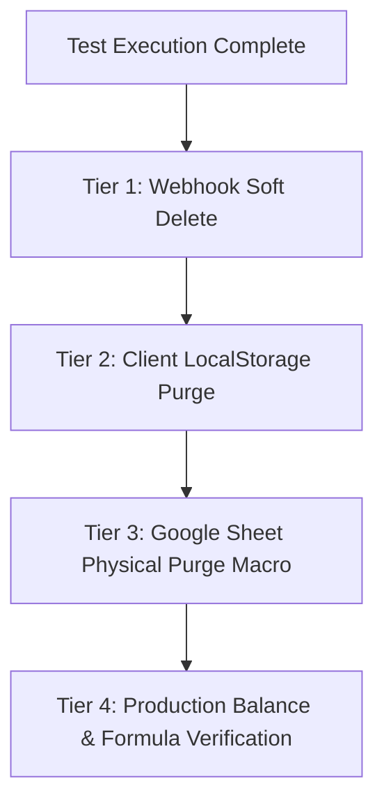

# Production Data Rollback Runbook: Narmada Ghat Nirman Dashboard

> [!CAUTION]
> **CRITICAL PRODUCTION SAFETY REQUIREMENT**
> The Koteshwar Ghat Nirman system connects to an active community Google Sheet (`1Gw-tjQuVRzp6jO57jdH7OzvfEx4Brw_DV6uRb1cUDt8`) tracking genuine religious donations and contractor pledges. Never test with arbitrary donor names or realistic receipts. Always follow this Rollback Runbook to ensure zero production contamination.

---

## 1. Test Isolation Rules (Mandatory Pre-requisites)

Before running ANY test on the production dashboard or webhook:

1. **Test Identification Tagging**:
   - Every test donor name MUST begin with the prefix: `TEST_QA_` (e.g. `TEST_QA_DONOR_ALPHA`).
   - Every test receipt number MUST begin with: `TEST-RCP-` (e.g. `TEST-RCP-9901`).
   - Every test karyakarta user session MUST use: `anilpatidar` or `qa_tester`.
2. **Pre-test State Backup**:
   - In `karyakarta.html` Settings, click **"संपूर्ण बैकअप (JSON)"** to download `koteshwar_backup.json` before performing any tests.
   - Alternatively, make a revision history note in the Google Sheet (`File > Version History > Name current version: "Pre-QA-Testing-Snapshot"`).
3. **Transaction Logging**:
   - Maintain a local log of all created test `sno` and `receiptNo` values to feed directly into the rollback scripts.

---

## 2. Multi-Tier Rollback Execution Procedure

The rollback process consists of 3 complementary layers:



---

### Tier 1: Automated Soft-Delete via Webhook API
Soft delete immediately hides the test records from all karyakarta devices and public portals, moving them safely to the `Deleted Archive` tab.

#### Step 1: Run the Rollback Script
```bash
node .agents/skills/narmada-ghat-nirman-testing/scripts/rollback_manager.js
```
Or dispatch direct Webhook DELETE payloads:
```bash
curl -X POST "https://script.google.com/macros/s/<DEPLOYMENT_ID>/exec" \
  -H "Content-Type: application/json" \
  -d '{"action": "deleteDeclaration", "data": {"sno": 99991, "name": "TEST_QA_DONOR", "deleted_by": "qa_rollback"}}'
```

---

### Tier 2: Client Browser LocalStorage Rollback
Even after sheet deletion, testing browsers may keep cached items in `localStorage`.

1. Open DevTools Console (`F12` -> **Console**) on `karyakarta.html`.
2. Execute the following cleanup snippet:
```javascript
(function purgeTestCache() {
  const isTest = (str) => /TEST_QA_|TEST-RCP-|TEST-/i.test(String(str || ''));

  // Clean custom declarations
  let decls = JSON.parse(localStorage.getItem('koteshwar_custom_declarations') || '[]');
  localStorage.setItem('koteshwar_custom_declarations', JSON.stringify(decls.filter(d => !isTest(d.name) && !isTest(d.receipt))));

  // Clean custom collections
  let colls = JSON.parse(localStorage.getItem('koteshwar_custom_collections') || '[]');
  localStorage.setItem('koteshwar_custom_collections', JSON.stringify(colls.filter(c => !isTest(c.donorName) && !isTest(c.receiptNo))));

  // Purge runtime caches
  localStorage.removeItem('koteshwar_declarations_cache');
  localStorage.removeItem('koteshwar_collections_ledger');
  localStorage.removeItem('koteshwar_deleted_declarations');

  console.log("Local test caches wiped cleanly.");
  if (typeof refreshPortalData === 'function') refreshPortalData(true);
})();
```

---

### Tier 3: Permanent Google Sheet Physical Purge Macro
To guarantee that the production Google Sheet has no orphaned test rows in `Live Declaration`, `Live Collection`, `Audit Log`, or `Deleted Archive`:

1. Open the Production Google Sheet:
   [Koteshwar Nirman Master Sheet](https://docs.google.com/spreadsheets/d/1Gw-tjQuVRzp6jO57jdH7OzvfEx4Brw_DV6uRb1cUDt8/edit)
2. Open **Extensions > Apps Script**.
3. At the bottom of `Code.gs` (or in a new script file `RollbackUtil.gs`), paste the following function:

```javascript
/**
 * ONE-CLICK PRODUCTION ROLLBACK MACRO
 * Deletes all rows matching TEST_QA_ prefix or test IDs from all production tabs.
 */
function purgeAllTestTransactions() {
  var ss = SpreadsheetApp.getActiveSpreadsheet();
  var namePrefix = "TEST_QA_";
  var rcptPrefix = "TEST-";

  // 1. Live Declaration Tab
  var s1 = ss.getSheetByName("Live Declaration");
  if (s1) {
    var v1 = s1.getDataRange().getValues();
    for (var i = v1.length - 1; i >= 1; i--) {
      var name = String(v1[i][1] || '').trim();
      var rcpt = String(v1[i][6] || '').trim();
      if (name.indexOf(namePrefix) === 0 || rcpt.indexOf(rcptPrefix) === 0 || name.toLowerCase() === 'test') {
        Logger.log("Deleting Live Declaration row " + (i + 1) + ": " + name);
        s1.deleteRow(i + 1);
      }
    }
  }

  // 2. Live Collection Tab
  var s2 = ss.getSheetByName("Live Collection");
  if (s2) {
    var v2 = s2.getDataRange().getValues();
    for (var j = v2.length - 1; j >= 1; j--) {
      var rNo = String(v2[j][1] || '').trim();
      var dName = String(v2[j][3] || '').trim();
      if (rNo.indexOf(rcptPrefix) === 0 || dName.indexOf(namePrefix) === 0) {
        Logger.log("Deleting Live Collection row " + (j + 1) + ": " + rNo);
        s2.deleteRow(j + 1);
      }
    }
  }

  // 3. Audit Log Tab
  var s3 = ss.getSheetByName("Audit Log");
  if (s3) {
    var v3 = s3.getDataRange().getValues();
    for (var k = v3.length - 1; k >= 1; k--) {
      var aId = String(v3[k][2] || '').trim();
      var aName = String(v3[k][3] || '').trim();
      if (aId.indexOf(rcptPrefix) === 0 || aName.indexOf(namePrefix) === 0) {
        s3.deleteRow(k + 1);
      }
    }
  }

  // 4. Deleted Archive Tab
  var s4 = ss.getSheetByName("Deleted Archive");
  if (s4) {
    var v4 = s4.getDataRange().getValues();
    for (var m = v4.length - 1; m >= 1; m--) {
      var archId = String(v4[m][2] || '').trim();
      var archName = String(v4[m][3] || '').trim();
      if (archId.indexOf(rcptPrefix) === 0 || archName.indexOf(namePrefix) === 0 || archName.toLowerCase() === 'test') {
        s4.deleteRow(m + 1);
      }
    }
  }

  Logger.log("✅ Production Rollback Completed Successfully.");
}
```
4. Select `purgeAllTestTransactions` from the dropdown and click **Run**.
5. Check Execution Log: Confirm row deletions and verify zero remaining test rows.

---

## 3. Post-Rollback Integrity Verification Checklist

After executing the rollback, complete this 4-point verification check:

- [ ] **Tab Row Counts**: `Live Declaration` and `Live Collection` row counts returned to their baseline numbers.
- [ ] **Summary Totals**: `index.html` totals (Total Declared, Total Received) match the pre-test figures.
- [ ] **Pending Ledger**: No orphaned `TEST_QA_` records in the Karyakarta Portal.
- [ ] **Sequence Continuity**: Confirm next manual declaration takes the correct contiguous `Sno` without skips.
